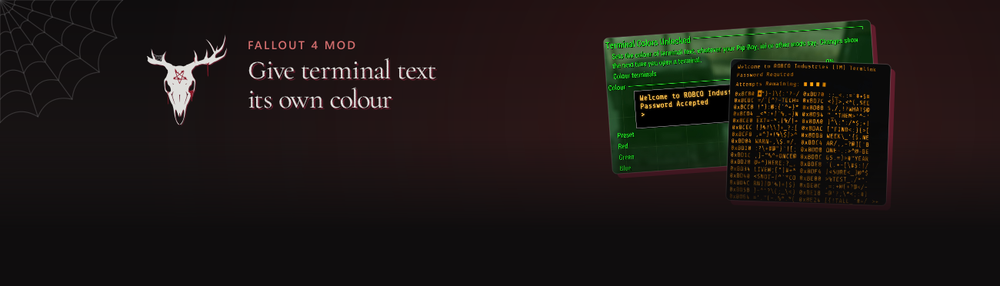
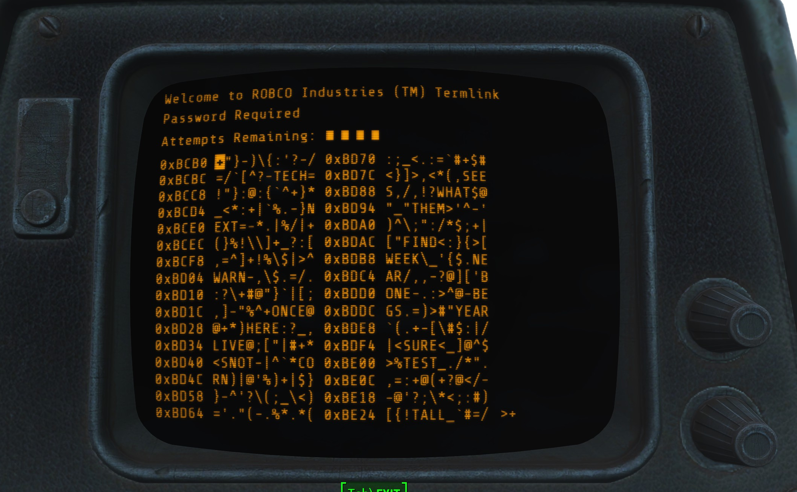
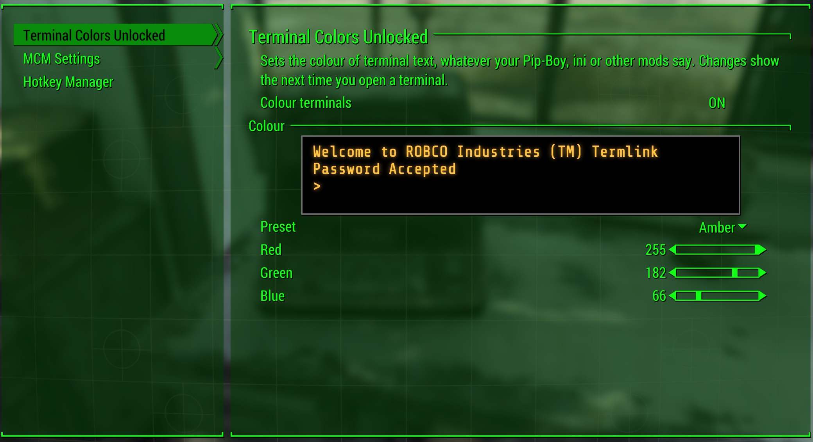

Pick the colour of terminal text, separate from your Pip-Boy. It works with Pip-Boy FX on or off and needs no ini edits.

<picture>
  <source media="(prefers-color-scheme: dark)" srcset="docs/divider.png">
  
</picture>

## How it works

- **Your colour on every terminal.** Terminal screens, holotapes played in a terminal and the terminal's buttons all use the colour you pick.
- **Pip-Boy FX on or off.** With FX on, the game draws terminals in your Pip-Boy colour, so the mod lends your terminal colour to the Pip-Boy while a terminal is open and puts your own colour back when you leave. With FX off, it tints the terminal screen directly.
- **No more white terminals.** Turning Pip-Boy FX off normally leaves terminal text plain white. Now it keeps a colour.

## What you get

- **An MCM page.** Presets (Classic green, Amber, White, Blue, Red), red, green and blue sliders, and a live preview of a terminal screen.
- **A settings holotape.** For players without MCM: the same presets and colour steps. It appears once among your holotapes. Play it inside a terminal to see changes as you make them.
- **A light plugin.** ESL-flagged, so it takes no load order slot.

## Install

1. Install with your mod manager.
2. The installer asks which version of Fallout 4 you play and marks the right one. Pick it.

**Needs:** F4SE (0.6.23 for 1.10.163, 0.7.x for later versions), Address Library for F4SE Plugins, and the Microsoft Visual C++ 2015-2022 redistributable (x64). MCM is optional.

**Tested on:** OG (1.10.163) and AE (1.11.240). NG (1.10.984): untested.

## Choose what it does

In MCM, open **Terminal Colors Unlocked**. Or play the **Terminal Colors Unlocked Settings** holotape.

- **Colour terminals:** on or off. Off leaves terminals exactly as the game draws them.
- **Preset:** pick a colour, or Custom to use the sliders.
- **Red, Green, Blue:** 0 to 255 each.

## Good to know

- Not compatible with other mods that change terminal colours. Use one at a time.
- With Pip-Boy FX on, your Pip-Boy colour only changes while a terminal is open, and only in memory: your saved settings are never touched.
- With Pip-Boy FX on, holotapes played on the Pip-Boy itself keep the Pip-Boy colour.
- Changes from MCM show the next time you open a terminal.

Build it yourself

- `src\` holds the Papyrus scripts, the terminal tint and MCM colour bar (ActionScript 3), the MCM config and the installer.
- `tools\build.ps1` compiles the scripts (Papyrus compiler, F4SE and vanilla script sources), builds the SWFs with FFDec, writes the plugin and packs the BA2. It looks for those tools in `shared\tools` beside this repo, or in `TCU_TOOLS`.
- `dll\` holds the F4SE plugin, which lets the scripts read the game's ini settings. `dll\og` (alandtse/CommonLibF4, CMake and vcpkg) builds the DLL for 1.10.163 and 1.10.984; `dll\ng` (libxse/commonlibf4, xmake) builds it for 1.11. Run each `build.bat` from a machine with Visual Studio 2022 Build Tools.
- `tools\build_release.ps1` makes the installer zip in `dist\release`.

## Report a problem

Open an issue here, or post in the Nexus page's Bugs tab, with your game version, F4SE version and what you saw. You can also find me on [Discord](https://discord.gg/QZHymBYMxP).

---

Made with AI. Claude contributed heavily under my direction: I decided what it does and checked it, and the AI wrote most of the code, its tests and these docs.

## Licence

GPL-3.0 (see `LICENSE`). The next-gen DLL is built with libxse/commonlibf4 (GPL-3.0 with a modding exception); the old-gen DLL with alandtse/CommonLibF4 (MIT).
